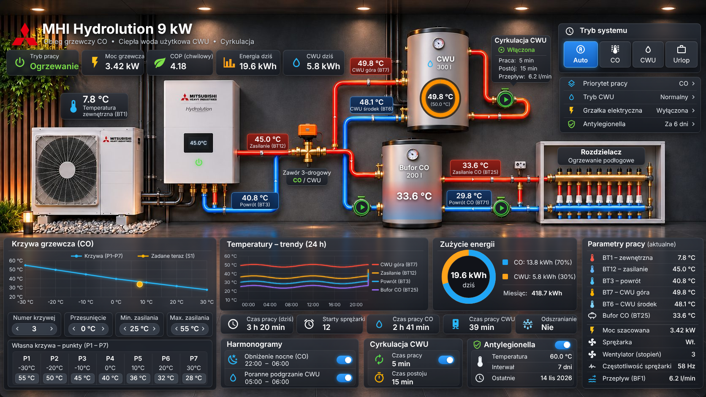

# Karta HA – pompa ciepła MHI Hydrolution

Dashboard Home Assistant dla pompy MHI Hydrolution (RC-HY40-W = NIBE SMO 40) czytanej przez ESP (ESPHome `hydrolution` v5.3, emulacja MODBUS40).
Jedna karta `picture-elements` na tle `tlo.png`. Na tło nakładane są kafle, panele i wartości na żywo w stylu wzoru.



Podgląd jest wygenerowany z przykładowymi wartościami. Wykres trendów to w HA `apexcharts-card`, a na podglądzie jest tylko atrapa.

## Co jest w repo

| Plik | Do czego |
|---|---|
| `dashboard/pompa_ciepla.yaml` | cały dashboard (szablony button-card + widok panel z kartą) |
| `packages/hydrolution_karta.yaml` | pakiet HA: moc grzewcza, moc elektryczna (szacunek), COP, energia dziś/miesiąc, czasy pracy dziś, starty dziś, tryb systemu, antylegionella, skrypty przycisków trybu |
| `www/hydrolution/tlo.png` | tło 1672×941 |
| `docs/wzor.png` | wzór, z którego robiona była karta |
| `dist/ha-karta-pompa-ciepla.js` + `hacs.json` | karta JS dla HACS (`type: custom:ha-karta-pompa-ciepla`) i panel boczny (`ha-pompa-ciepla-panel`) |
| `dashboard/pompa_ciepla_js.yaml` | osobny dashboard (zakładka w menu) z kartą JS |
| `tools/` | generator: `python3 gen.py karta.yaml preview.html dist.js v1.x`, podgląd `node shot.js` / `node jsshot.js` |

Kod ESP (v5.3) nie jest w tym repo.

## Instalacja przez HACS (karta JS, zalecane)

Karta `custom:ha-karta-pompa-ciepla` to jeden plik JS. Nie potrzebuje button-card, apexcharts-card ani card-mod, a tło ma wbudowane.

1. HACS → ⋮ → **Custom repositories** → `https://github.com/voltronicpl/ha-karta-pompa-ciepla`, typ **Dashboard** → Dodaj → Pobierz. Przeładuj przeglądarkę.
2. Wgraj pakiet `packages/hydrolution_karta.yaml` tak jak w kroku 3 instalacji ręcznej niżej. Bez niego nie będzie COP, energii, czasów pracy ani przycisków trybu.
3. Dodaj kartę. Najlepiej w widoku typu **Panel**, wtedy zajmuje całą szerokość:
   ```yaml
   type: custom:ha-karta-pompa-ciepla
   # opcjonalnie:
   # image: /local/hydrolution/tlo.png     # własne tło 1672x941 zamiast wbudowanego
   # entities:                             # gdy masz inne ID encji
   #   bt1: sensor.moja_temperatura_zewnetrzna
   ```
   Klucze encji (`bt1`, `bt12`, `prio`, `pwr`…) są wypisane na początku pliku `dist/ha-karta-pompa-ciepla.js` (`DEFAULT_E`).

Wykres trendów 24 h karta rysuje sama z historii HA i odświeża go co 5 minut.

## Osobna zakładka w lewym menu HA

**Automatycznie (od v1.5):** po instalacji z HACS i przeładowaniu przeglądarki, przy pierwszym wejściu do HA na koncie **admina**, karta sama zakłada dashboard „Pompa ciepła” (`/pompa-ciepla`, ikona `mdi:heat-pump`) i pokazuje go w lewym menu. Nie trzeba ruszać `configuration.yaml`.
- Robi to tylko raz w danej przeglądarce. Jeśli dashboard `pompa-ciepla` już istnieje, nic nie zmienia.
- Na koncie bez uprawnień admina nic nie robi.
- Jak usuniesz ten dashboard, sam nie wróci. Gdybyś chciał, żeby karta założyła go jeszcze raz, w konsoli przeglądarki (F12) wpisz `localStorage.removeItem('hkpc_auto_dashboard')` i odśwież stronę.
- Żeby wyłączyć to w ogóle, przed instalacją wpisz w konsoli `localStorage.setItem('hkpc_auto_dashboard','off')`.

Jeśli wolisz zrobić to ręcznie:

**Sposób A, dashboard (najprościej):**
1. **Ustawienia → Dashboardy → Dodaj dashboard → Nowy dashboard od zera.** Tytuł „Pompa ciepła”, ikona `mdi:heat-pump`, włącz **Pokaż w pasku bocznym**.
2. Otwórz go i wejdź w **Edytuj → ⋮ → Edytor kodu (raw)**. Wklej `dashboard/pompa_ciepla_js.yaml` (widok typu Panel z kartą na całą szerokość).

**Sposób B, panel bez edytora dashboardów (`panel_custom`):** dopisz do `configuration.yaml` i zrestartuj HA:
```yaml
panel_custom:
  - name: ha-pompa-ciepla-panel
    url_path: pompa-ciepla
    sidebar_title: Pompa ciepła
    sidebar_icon: mdi:heat-pump
    module_url: /hacsfiles/ha-karta-pompa-ciepla/ha-karta-pompa-ciepla.js
    # config:                     # opcjonalnie, to samo co w karcie
    #   entities:
    #     bt1: sensor.moja_temperatura_zewnetrzna
```
Panel ma pasek z tytułem i przyciskiem menu. Karta jest dopasowana do ekranu (szerokość i wysokość).

## Instalacja ręczna (YAML, button-card)

1. **HACS → Frontend**: zainstaluj `button-card`, `apexcharts-card`, `card-mod` i przeładuj przeglądarkę.
   - HACS: https://hacs.xyz/docs/use/
   - button-card: https://github.com/custom-cards/button-card
     [](https://my.home-assistant.io/redirect/hacs_repository/?owner=custom-cards&repository=button-card&category=plugin)
   - apexcharts-card: https://github.com/RomRider/apexcharts-card
     [](https://my.home-assistant.io/redirect/hacs_repository/?owner=RomRider&repository=apexcharts-card&category=plugin)
   - card-mod: https://github.com/thomasloven/lovelace-card-mod
     [](https://my.home-assistant.io/redirect/hacs_repository/?owner=thomasloven&repository=lovelace-card-mod&category=plugin)
2. Skopiuj `www/hydrolution/tlo.png` do `/config/www/hydrolution/tlo.png`.
3. Skopiuj `packages/hydrolution_karta.yaml` do `/config/packages/`. W `configuration.yaml` dodaj (jeśli nie masz):
   ```yaml
   homeassistant:
     packages: !include_dir_named packages
   ```
   Potem sprawdź konfigurację i zrestartuj HA.
4. **Ustawienia → Dashboardy → Dodaj dashboard** (od zera). Otwórz go, wejdź w **Edytuj → ⋮ → Edytor kodu (raw)** i wklej całość `dashboard/pompa_ciepla.yaml`.
5. ESP musi mieć wgrane v5.3, bo karta używa encji z v5.3: przepływ BF1, tryb pracy, ogrzewanie dozwolone, temp. stop CWU, wentylator i prąd jednostki zewnętrznej.

## Jak to działa

- Pozycje elementów są w % tła, więc karta skaluje się razem z obrazkiem. Czcionki są w jednostkach `cqw` (kontener = karta), więc też się skalują. Widok jest typu `panel`, czyli karta na całą szerokość.
- Kliknięcie w wartość otwiera okno encji (more-info). Przyciski robią tak:
  - **Tryb systemu**: odpala skrypty `script.hp_tryb_*`.
  - **Strzałki ‹ ›** przy krzywej: `number.set_value` ±1, z pilnowaniem min/max.
  - **Przełączniki**: harmonogram nocny, harmonogram CWU i antylegionella przełączają encje ESP.
- Encje mają domyślne ID z ESPHome (`sensor.hydrolution_...`). Jeśli masz inne, zmień je w `tools/gen.py` (słownik `E`) i wygeneruj plik jeszcze raz, albo zamień je ręcznie w YAML-u.

## Ograniczenia (uczciwie)

- **Tryb systemu Auto/CO/CWU/Urlop**: SMO40 nie ma takiego jednego rejestru. Mapowanie jest takie: Auto = tryb pracy Auto. CO = Ręczny + ogrzewanie dozwolone. CWU = Ręczny + ogrzewanie zablokowane. Urlop = tryb urlopowy. **Sprawdź na sterowniku**, zanim zaczniesz na tym polegać.
- **Bufor CO** pokazuje BT25 (zasilanie zewnętrzne), bo SMO40 nie ma osobnego czujnika bufora. Zasilanie i powrót CO to BT25 i BT71, a nie BT14/BT15 jak na wzorze. BT14 to gorące gazy, a BT15 to linia cieczy.
- **Moc elektryczna / COP** to szacunek: prąd jednostki zewnętrznej (rejestr 44866) × 230 V + grzałka. Napięcie zmienisz w pakiecie.
- **Moc grzewcza** liczona jest z przepływu BF1 × ΔT (BT12−BT3). Gdy przepływ = 0 albo go nie ma, brana jest wartość 44706 z ESP (całe kW).
- **Wentylator** pokazuje stopień (rejestr 44979), a nie %. SMO40 nie podaje % dla EB101.
- **Cyrkulacja CWU** nie ma rejestru stanu pompy. „Włączona” i przełącznik pokazują tylko, że czas pracy > 0. Kliknięcie otwiera nastawę.
- **Antylegionella – ostatnie** zapisuje HA w chwili, gdy BT7 dojdzie do temp. końcowej −1 °C. Do pierwszego przegrzania pokazuje „–”.
- **Krzywa grzewcza**: punkty P1–P7 są rysowane dla −30, −20, −10, 0, 10, 20, 30 °C, czyli tak jak w menu własnej krzywej NIBE. Przesunięcie krzywej jest doliczone. Pomarańczowa kropka to aktualne BT1 i zadane S1.
- Ostatni kafel w rzędzie (pusty na wzorze) pokazuje odszranianie.

## Harmonogram tygodniowy (od v1.11)

Pod mapą karta ma blok **„Harmonogram”**: plan Pn–Nd z osią 0–24 h dla pięciu funkcji (obniżenie CO, tryb CWU wg godzin, cyrkulacja CWU, grzałka, jednorazowe podgrzanie CWU). Okna przeciągasz myszą po osi (krok 15 min), klikasz, żeby edytować godziny, ⧉ kopiuje dzień na wszystkie dni, a **Zapisz harmonogram** wysyła plan do HA. Całością rządzi Home Assistant, ESP niczego nie planuje.

Wymagania:
1. Pakiet `packages/hydrolution_karta.yaml` (pomocnicze przełączniki, wartości i automatyzacje) i `packages: !include_dir_named packages` w `configuration.yaml`, potem przeładowanie konfiguracji.
2. Harmonogramy `schedule.hp_plan_*`: konto administratora klika w bloku **Utwórz harmonogramy**. Edycja okien też wymaga administratora.
3. Każdą funkcję włączasz jej przełącznikiem w bloku (domyślnie wyłączone, nic nie rusza ustawień pompy).

Poza oknem cyrkulacja ma pracę 1 min / postój 60 min, bo sterownik SMO40 nie ma pełnego wyłączenia.

## Zakładka Nauka i dopasowanie do ekranu (od v1.14)

Pod kartą są dwie zakładki: **Harmonogram** i **Nauka**. Nauka jest tylko do podglądu i nic nie zmienia w pompie.

- **Krzywa grzewcza: obecna i proponowana.** Karta bierze z historii HA (statystyki godzinowe recordera) temperaturę zewnętrzną BT1 i temperaturę w domu, a z Open-Meteo (`api.open-meteo.com`, położenie domu z ustawień HA) wiatr, zachmurzenie i nasłonecznienie z tych samych godzin. Liczy, przy jakich temperaturach zewnętrznych w domu było za ciepło lub za zimno (godziny 8–22), i ile trzeba przesunąć punkty P1–P7, żeby było równo. Do tego dokłada poprawkę na prognozę słońca i wiatru na najbliższe 12 h. Pod wykresem jest lista, co przesunęło propozycję. Punkty ustawiasz sam w panelu „Własna krzywa”.
- **Cyrkulacja CWU: proponowany harmonogram Pn–Nd** z historii obecności telefonów (`person.*`). Zasady: dom pusty = wyłączona, jesteście i nie śpicie = włączona, sen = wyłączona. Sen wykrywa z nocnych okien obecności bez aktywności (światła, media, ładowanie/ekran telefonów). Przycisk **Wyślij na główną** wpisuje okna do harmonogramu „Cyrkulacja CWU” w zakładce Harmonogram jako niezapisane zmiany. Zapisujesz sam przyciskiem „Zapisz harmonogram” (albo „Cofnij zmiany”). Przełącznik „Aktywne” nie jest ruszany.
- **Kafle** pokazują, ile dni historii faktycznie użyto do krzywej i do cyrkulacji.
- **Źródła nauki:** własna lista encji (temperatura w domu, osoby/telefony, aktywność, czujniki pogody). Dodajesz i usuwasz w zakładce Nauka. Lista jest zapisywana w HA (dane użytkownika frontendu) i nie zmienia samych encji. „Auto” wraca do wykrywania automatycznego.

Opcjonalnie w konfiguracji karty:
```yaml
nauka:
  cel: 21.5          # docelowa temp. w domu (domyślnie mediana z historii)
  dni_krzywa: 60     # max dni historii do krzywej (max 92)
  dni_cyrkulacja: 28 # max dni historii do cyrkulacji
dopasuj_ekran: true  # false = stare zachowanie (karta na całą szerokość)
# ekran_gora: 64     # ile px zajmuje pasek HA nad kartą (domyślnie mierzone)
```

**Dopasowanie do ekranu:** na komputerze mapa razem z całym dolnym rzędem paneli (krzywa grzewcza, P1–P7, przyciski) mieści się w oknie bez przewijania. Karta skaluje się z szerokości i wysokości okna z zachowaniem proporcji. Harmonogram i Nauka są niżej, po przewinięciu. Telefon (do 700 px) działa jak w v1.13.

## v1.15: automatyczna cyrkulacja, pomiar pompy, prognoza vs rzeczywistość, „Chcę w domu”

- **Automatyzacja cyrkulacji** (suwak w Nauce, `input_boolean.hp_auto_cyrk`, domyślnie wyłączony). Włączona: cyrkulacja CWU idzie wg harmonogramu „Cyrkulacja CWU” i obecności telefonów (`zone.home`). Wszyscy wyszli na 10 min = wyłączona, ktoś wrócił = od razu wg harmonogramu, pora snu blokuje (okna z Nauki omijają sen). Gdy jest włączona, stara automatyzacja `hp_plan_cyrk` czeka. Wymaga pakietu z tej wersji.
- W Nauce przy cyrkulacji: stan teraz i powód (pusty dom / ktoś jest / sen / poza oknem), czerwona kreska „teraz”, żółta kreska = obecny harmonogram na głównej, okna można poprawić ręcznie (przeciągnij = dodaj, klik = zmień/usuń, ⧉ = kopiuj dzień) przed „Wyślij na główną”.
- **Temperatura zewnętrzna z pompy (BT1)** idzie do nauki. Pakiet dodaje `sensor.hp_temperatura_zewnetrzna_bt1` (statystyki długoterminowe, własna historia). Open-Meteo jest tylko symulacją tam, gdzie pomiaru brak, i prognozą. Wykres: pomiar pompy vs symulacja, 7 dni wstecz + 2 dni do przodu.
- **Prognoza vs rzeczywistość:** prognoza Open-Meteo wydana dobę wcześniej (archiwum `previous-runs-api.open-meteo.com`) na tle pomiaru BT1, średni błąd, przechył i największa pomyłka.
- **„Chcę w domu: __ °C”** przy wykresie krzywej: proponowana krzywa liczy się dla tej temperatury w domu. Temperatura w domu z czujnika salonu (osobna pozycja w „Źródłach nauki”, wykrywany po nazwie „salon”, można zmienić).

### Co wkleić w HA (v1.15+), krok po kroku

1. HACS → „Karta pompy ciepła” → ⋮ → Pobierz najnowszą wersję → odśwież przeglądarkę (Ctrl+F5).
2. Zrób kopię `/config/packages/hydrolution_karta.yaml` (np. File editor → zapisz jako `hydrolution_karta.yaml.bak`), potem wklej tam całą treść `packages/hydrolution_karta.yaml` z repo. Dochodzi: `input_boolean.hp_auto_cyrk` (wyłączony), automatyzacja „HP auto: cyrkulacja CWU wg harmonogramu i obecności”, `sensor.hp_temperatura_zewnetrzna_bt1`. W starej automatyzacji „HP plan: cyrkulacja CWU” dochodzi tylko warunek „czekaj, gdy auto włączone”.
3. Narzędzia deweloperskie → YAML → „Sprawdź konfigurację”, potem przeładuj: Przełączniki (input boolean), Encje szablonów, Automatyzacje. Restart nie jest potrzebny.
4. Karta → zakładka **Nauka** → na dole „Źródła nauki” → „Czujnik salonu”: wpisz albo wybierz swój czujnik salonu (np. `sensor.czujnik_temperatury_salon_temperature`) → **Ustaw**. Karta sama szuka encji z „salon” w nazwie, więc zwykle jest już ustawiony.
5. Suwak „Automatyzacja cyrkulacji” w Nauce włączasz sam, kiedy chcesz.

## v1.17: pora wstawania

W Nauce przy cyrkulacji jest „Pora wstawania”, osobno Pn–Pt i So–Nd: **Auto** (mediana końca wykrytego snu z historii telefonów i aktywności; bez historii 6:30 w tygodniu i 8:00 w weekend) albo **Ręcznie** (godzina). Cyrkulacja dostaje okno od „wstanie − X min” (domyślnie 20, do zmiany) do pół godziny po wstaniu. Na wykresie jest znacznik ⏰ z godziną. Ustawienia zapisują się w HA razem ze „Źródłami nauki”. Pakietu HA nie trzeba zmieniać.

## v1.18: weekend = wstanie z czujników

Pora wstawania Pn–Pt jest stała (z historii albo ręcznie). W weekend godzina to tylko sugestia: pakiet dodaje `binary_sensor.hp_aktywnosc_w_domu` (światła, ruch/obecność, ekran telefonu, media), `input_datetime.hp_wstalismy` i automatyzację „HP auto: weekend - wstalismy (cyrkulacja)”. Przy włączonej automatyzacji cyrkulacji pierwsza aktywność rano w So/Nd (5:00–11:00, ktoś w domu) zapisuje godzinę wstania i włącza cyrkulację na 60 min. Bez sygnału zostaje okno z sugestii w harmonogramie. Wymaga wklejenia nowego pakietu (kroki jak wyżej, przeładuj też „Pomocnicy daty/czasu”).
Uwaga: jeśli jakieś światło świeci całą noc, sensor aktywności już jest „on” i rano nie zmieni stanu; wtedy działa tylko okno z sugestii.

## v1.19: po wyjściu / po wstaniu / Przelicz ze zmianami

- „Po wyjściu wszystkich wyłącz po __ min” (domyślnie 5) w Nauce, zapisywane w `input_number.hp_cyrk_po_wyjsciu` i używane przez automatyzację cyrkulacji.
- „i __ min po wstaniu” (domyślnie 30): okno po wstaniu trwa od X min przed do Y min po wstaniu (w weekend tyle trwa cyrkulacja po wykryciu wstania, `input_number.hp_cyrk_po_wstaniu`). Jeśli zwykle jesteście wtedy w domu i nie śpicie, łączy się z oknem obecności i wychodzi dłużej.
- „Przelicz” pokazuje, co się zmieniło od poprzedniego liczenia: lista różnic (punkty krzywej, pora wstawania, okna cyrkulacji dzień po dniu), szara przerywana linia na wykresie krzywej i szare ramki starych okien. Nic się nie zapisuje do harmonogramu bez „Wyślij na główną”.
- Wymaga wklejenia nowego pakietu (dwa nowe `input_number`). Karta przy pierwszym uruchomieniu wpisze w nie 5 i 30.

## v1.20: po wstaniu cyrkulacja chodzi, dopóki jesteście w domu

Propozycja w Nauce to jedno okno na dzień: od „X min przed wstaniem” aż do pory snu (pora snu z historii, osobno dla każdego dnia tygodnia). W tym oknie automatyzacja trzyma cyrkulację włączoną cały czas, dopóki ktoś jest w domu. Wyłącza się, gdy wszyscy wyjdą (po czasie „po wyjściu”, domyślnie 5 min) albo gdy kończy się okno, czyli zaczyna się pora snu. Gdy ktoś wróci, od razu się włącza. W weekend rusza od wykrytego wstania i chodzi tak samo. Pole „min. __ min pracy po wstaniu” (domyślnie 30) to teraz minimalny czas pracy od startu okna rano albo od wykrycia wstania, nawet jeśli wszyscy wyjdą wcześniej. Automatyzacja sprawdza stan co 5 min. Wymaga wklejenia nowego pakietu.

## v1.21: weekend też z poboru ciepłej wody, bez „min. pracy po wstaniu”

- **Usunięte:** pole „min. __ min pracy po wstaniu” i `input_number.hp_cyrk_po_wstaniu` (opisy przy v1.19 i v1.20 wyżej są już nieaktualne w tym punkcie). Po wstaniu cyrkulacja chodzi do wyjścia ostatniego telefonu (+ „po wyjściu”, domyślnie 5 min) albo do pory snu.
- **Dodane:** drugi sygnał wstania w weekend (5:00–11:00): pobór ciepłej wody. Pakiet liczy tempo zmiany temperatury środka zasobnika CWU (`sensor.hp_cwu_srodek_zmiana`, pochodna BT6). Spadek szybszy niż 0,06 °C/min przez 30 s = ktoś odkręcił ciepłą wodę → zapis godziny wstania i start cyrkulacji (przy włączonej automatyzacji). Który sygnał zadziałał, zapisuje `input_text.hp_wstalismy_zrodlo` (woda / aktywnosc), a karta to pokazuje.
- Czujnik przepływu BF1 pompy mierzy przepływ w obiegu pompy, nie w kranie, więc nie nadaje się do wykrycia odkręcenia wody. Dlatego sygnałem jest spadek BT6.
- Wymaga wklejenia nowego pakietu (przeładuj też Pomocników tekstowych i liczbowych). Stary `input_number.hp_cyrk_po_wstaniu` po wklejeniu zniknie z HA sam.

## v1.22: karta sama wykrywa stary pakiet w HA

**Wersja pakietu HA: 1.22.** Pakiet `packages/hydrolution_karta.yaml` ma na górze „WERSJA PAKIETU” i dodaje `sensor.hp_pakiet_wersja` (stan = numer wersji). Karta porównuje go z wersją, której oczekuje, i sprawdza, czy są encje i automatyzacje z pakietu: `input_boolean.hp_auto_cyrk`, `input_number.hp_cyrk_po_wyjsciu`, `input_datetime.hp_wstalismy`, `input_text.hp_wstalismy_zrodlo`, `sensor.hp_cwu_srodek_zmiana`, `binary_sensor.hp_aktywnosc_w_domu`, `sensor.hp_temperatura_zewnetrzna_bt1`, automatyzacje `hp_auto_cyrk` i `hp_auto_wstali`.

Jeśli czegoś brakuje albo wersja jest starsza, na górze karty pojawia się żółty pasek „Masz stary pakiet w HA” (klik = przejście do Nauki), a w Nauce żółta ramka z listą brakujących rzeczy i instrukcją:

1. Zrób kopię `/config/packages/hydrolution_karta.yaml`.
2. Wklej tam całą treść `packages/hydrolution_karta.yaml` z repo.
3. Narzędzia deweloperskie → YAML → Sprawdź konfigurację.
4. **Pełny restart HA** (Ustawienia → ⋮ → Uruchom ponownie). Samo przeładowanie nie wystarcza, bo dochodzą nowe pomocniki i sensory szablonów.

## v1.23: harmonogram „Automatyczny” i CWU wg taryfy G12

**Wersja pakietu HA: 1.23.** Trzeba wkleić nowy pakiet i zrobić **pełny restart HA**.

- **Główna → Harmonogram:** gdy w Nauce jest włączona „Automatyzacja cyrkulacji” (albo nowa „Automatyzacja CWU”), zakładka „Cyrkulacja CWU” (albo „Tryb CWU”) ma znaczek **auto** i napis **Automatyczny**. Karta sama wpisuje do harmonogramu w HA plan z Nauki (sprawdza co kilka minut, zapisuje tylko, gdy plan się zmienił). Ręczna edycja tego harmonogramu jest wtedy zablokowana. Wyłączysz automatyzację w Nauce i znowu edytujesz sam.
- **Nauka → CWU: grzanie wody w taniej taryfie G12:** wykres Pn–Nd z tanimi strefami G12, zużyciem ciepłej wody (szybkie spadki BT6 z ostatnich 14 dni), pracą sprężarki na CWU (ostatni tydzień) i propozycją okien grzania. Propozycja = tanie strefy, po których do następnej taniej zużywacie wodę (próg 0,5 °C, do zmiany). Każdy dzień ma co najmniej jedną strefę. „Wyślij na główną” wpisuje to do harmonogramu „Tryb CWU” (bez auto trzeba kliknąć „Zapisz harmonogram”).
- **Taryfa:** PGE G12 standard, codziennie cały rok 22:00–6:00 i 13:00–15:00. Godziny zmieniasz w Nauce (`input_text.hp_g12_strefy`, format `22:00-06:00,13:00-15:00`), jest też opcja „So–Nd cała doba tania” (`input_boolean.hp_g12_weekend_tani`, domyślnie wyłączona).
- **Automatyzacja CWU** (`input_boolean.hp_auto_cwu`, domyślnie wyłączona, suwak w Nauce), automatyzacja „HP auto: CWU wg taryfy G12”:
  - w oknie harmonogramu „Tryb CWU” (tania strefa) ustawia tryb „w oknie” (domyślnie **Luksus**), czyli nagrzewa na zapas;
  - poza oknem ustawia tryb „poza oknem” (domyślnie **Normalny**), więc pompa dogrzeje drugi raz dopiero, gdy woda spadnie poniżej progu Normalnego;
  - gdy do okna zostało ≤ 30 min (`input_number.hp_cwu_czekaj_min`, do zmiany w Nauce), ustawia **Ekonomiczny** i czeka na tanią strefę;
  - pusty harmonogram = okna z samej taryfy (`binary_sensor.hp_g12_tania_strefa`). Gdy jest włączona, stara „HP plan: tryb CWU wg godzin” czeka.
- Nowe w pakiecie: `binary_sensor.hp_g12_tania_strefa`, `sensor.hp_g12_do_taniej`, `input_boolean.hp_auto_cwu`, `input_boolean.hp_g12_weekend_tani`, `input_number.hp_cwu_czekaj_min` (karta wpisze 30 przy pierwszym uruchomieniu), `input_text.hp_g12_strefy`, automatyzacja `hp_auto_cwu`. W „HP plan: tryb CWU wg godzin” doszedł warunek „czekaj, gdy auto CWU włączone”.

## v1.24: poprawka nazwy encji taryfy G12

W v1.23 encja tanie strefy powstawała w HA jako `binary_sensor.hp_g12_tania_strefa` (HA bierze ID z nazwy „HP G12 tania strefa”), a pakiet i karta szukały `binary_sensor.hp_g12_tania`. Przez to „do taniej” liczyło źle w taniej strefie i karta pokazywała stary pakiet. Teraz wszędzie jest `binary_sensor.hp_g12_tania_strefa`. **Wersja pakietu: 1.24.** Po wklejeniu wystarczy przeładować „Encje szablonów” i „Automatyzacje” (pełny restart też jest OK).

## v1.25: suwaki w Nauce przełączają się od razu, CWU przy małej historii

- **Poprawka:** po kliknięciu suwaka w Nauce (Automatyzacja cyrkulacji / CWU) przycisk zostawał z focusem i karta wstrzymywała odświeżanie, więc suwak wyglądał na martwy, a drugi klik wyłączał z powrotem. Teraz odświeżanie wstrzymuje się tylko przy pisaniu w polu.
- **Poprawka:** przy mniej niż 7 dniach historii zużycia wody (albo bez każdego dnia tygodnia) propozycja CWU = wszystkie tanie strefy (wcześniej przy pustej historii zostawała tylko 13–15, bez nocy). Liczenie dni historii obejmuje też bieżący dzień. Przy remisie wybierana jest dłuższa strefa (noc).
- Pakiet HA bez zmian (1.24).

## v1.26: tryby CWU na wykresie, Priorytet pracy = Auto / Ręcznie

- **Nauka → CWU:** wykres w kolorach trybu CWU: niebieski = tryb „w oknie” (domyślnie **Luksus**, grzanie w taniej strefie), fioletowy = **Ekonomiczny** (ostatnie 30 min przed tanią, czeka), szary = tryb „poza oknem” (domyślnie **Normalny**, dogrzewa tylko poniżej progu). Godziny przy blokach, legenda.
- **Główna → Harmonogram → Tryb CWU:** pod osią każdego dnia pasek z tymi samymi kolorami (Ekonomiczny tylko przy włączonej automatyzacji CWU, bo tylko ona go ustawia).
- **Priorytet pracy** (lista statusów w panelu po prawej): kliknięcie otwiera wybór **Auto** / **Ręcznie** (`select.hydrolution_tryb_pracy`, rejestr 47137). Auto = pompa sama decyduje CO/CWU. Po wybraniu Ręcznie są dwa przełączniki: **CO** (`switch.hydrolution_ogrzewanie_dozwolone`, 47371) i **CWU** (`switch.hydrolution_produkcja_cwu`, 47387). CO wł/wył działa tylko w trybie Ręczny / Tylko grzałka; „Produkcja CWU” na SMO40 może nie działać. Sam „Priorytet pracy” (43086) to tylko odczyt tego, co pompa robi teraz.
- Pakiet HA i ESP bez zmian (pakiet 1.24).

## v1.27: woda zawsze Normalny, w taniej strefie luksus jednorazowy z wstrzymanym CO (pakiet 1.25)

- **Tryb CWU zawsze Normalny** (tryb „poza oknem”). ≤ 30 min przed tanią strefą: **Ekonomiczny**, czeka.
- **Wejście w tanią strefę G12** (22–6, 13–15), gdy BT7 < cel luksusu − 2 °C: **luksus jednorazowy** (`select.hydrolution_podgrzanie_cwu_jednorazowe` = Jednorazowo, rejestr 48132), **tryb pracy Ręczny** i **ogrzewanie CO wyłączone**, cała moc idzie w wodę. Najwyżej raz na 90 min.
- **Koniec:** BT7 doszło do celu luksusu albo luksus się skończył → **tryb pracy Auto + ogrzewanie dozwolone**.
- **Bezpieczniki (CO nie zostaje wyłączone na stałe):** maks. czas luksusu (Nauka → CWU, domyślnie **60 min**, `input_number.hp_cwu_lux_max`), restart HA, wyjście z taniej strefy, wyłączenie automatyzacji CWU → wraca na Auto + CO.
- **Przycisk „CWU”** na głównej robi to samo (luksus jednorazowy + CO wstrzymane do zagrzania, max czas jak wyżej), już nie wyłącza CO na stałe. **„Auto”** przerywa i od razu wraca na Auto z CO.
- Nauka → CWU: pole „maks. czas luksusu”, linia stanu (tryb pracy, CO, podgrzanie jednorazowe, ile trwa luksus).
- Pakiet HA **1.25**: nowe `input_number.hp_cwu_lux_max`, `input_text.hp_cwu_boost`, `input_datetime.hp_cwu_boost_ostatnio`, skrypty `hp_cwu_boost_start` / `hp_cwu_boost_stop`, automatyzacja `hp_cwu_boost_koniec`; zmienione `hp_auto_cwu`, `hp_tryb_auto`, `hp_tryb_co`, `hp_tryb_cwu`. Wklej pakiet i zrób **pełny restart HA**.

## v1.28: karta sama instaluje i aktualizuje pakiet HA (bez wklejania plików)

- **Nauka → „Zainstaluj / napraw pakiet”** (tylko konto administratora HA). Karta najpierw pokazuje listę tego, co dołoży, a zakłada dopiero po kliknięciu. Robi to przez API Home Assistanta, bez restartu:
  - pomocniki `input_boolean` / `input_number` / `input_text` / `input_datetime` / `input_select` (wartości domyślne tylko dla świeżych: 5 min po wyjściu, 60 min luksus, 30 min czekaj, strefy G12, Luksus / Normalny, −2 / 0, 60 / 0),
  - skrypty i automatyzacje (do `scripts.yaml` i `automations.yaml`, z opisem „Utworzone przez kartę…”),
  - czujniki szablonowe, liczniki `utility_meter`, `history_stats` i `derivative` jako pomocnicy z interfejsu (te same nazwy encji co w pakiecie YAML),
  - czujnik „antylegionella ostatnio” (w YAML jest wyzwalany szablonem, czego API nie umie) karta robi jako pomocnik + automatyzacja + szablon, pod tą samą nazwą encji.
- **Aktualizacje same z HACS:** gdy pakiet jest zainstalowany przez kartę (`input_text.hp_pakiet_karta` = wersja), po aktualizacji karty dokłada brakujące i poprawia **swoje** elementy zmienione w nowszej wersji, i pokazuje komunikat, co zrobiła. Twoich własnych encji i automatyzacji nie rusza, niczego nie kasuje.
- **Pakiet YAML ma pierwszeństwo:** gdy w HA jest plik `packages/hydrolution_karta.yaml`, karta niczego nie zakłada (żeby nie było podwójnych encji i automatyzacji). Pokazuje, co jest nowe, i dwie drogi: A) wkleić nowy plik + pełny restart (jak dotąd), B) raz zmienić nazwę pliku na `hydrolution_karta.yaml.bak`, pełny restart, potem „Zainstaluj / napraw pakiet”, i od tej pory aktualizuje się samo.
- Po pakiecie YAML HA zostawia w rejestrze encji stare wpisy czujników szablonowych (encja „niedostępna”), które trzymają nazwy. Karta je pokazuje i daje przycisk **„Zwolnij nazwy”** (usuwa tylko te osierocone wpisy, na kliknięcie; historia zostaje), albo usuwasz je sam w Ustawienia → Encje.
- Plik `packages/hydrolution_karta.yaml` zostaje w repo jako plan B (wersja pakietu bez zmian: 1.25). Spis dla karty generuje `tools/pkgspec.py` z tego pliku (wersja każdego elementu z historii gita).
- Sprawdzone na testowym Home Assistant 2026.2: instalacja od zera, przejście z pakietu YAML (zwolnienie nazw + instalacja, te same nazwy encji) i samoczynna aktualizacja ze starszej wersji (zmiana zachowuje ustawione wartości).

## v1.29: bez duplikatów przy kilku otwartych urządzeniach

- Instalacja / aktualizacja pakietu przez kartę ma teraz blokadę wspólną dla wszystkich przeglądarek i telefonów admina (w danych użytkownika HA). Wcześniej, gdy karta była otwarta naraz np. na komputerze i telefonie, oba urządzenia zakładały to samo i powstawały duplikaty czujników z „_2” albo „hydrolution_hp_…”.
- Przed założeniem czujnika karta jeszcze raz sprawdza, czy ktoś go w międzyczasie nie założył.

## v1.30: dane przy kropce krzywej, temperatura domu przy rozdzielaczu

- **Krzywa grzewcza:** przy żółtej kropce jest teraz opis: temperatura powietrza (BT1) → zadana temperatura wody (S1) oraz aktualne zasilanie CO (BT25). Po najechaniu na kropkę to samo w podpowiedzi.
- **Mapa:** obok rozdzielacza (ogrzewanie podłogowe) zielony znacznik **„W domu (salon)”** z temperaturą z czujnika salonu ustawionego w Nauce → „Źródła nauki” (albo wykrytego automatycznie). Kliknięcie otwiera encję. Można nadpisać w konfiguracji karty: `entities: {dom: sensor.twoj_czujnik}`.

## v1.31: wybór trybu CWU dla taniej i drogiej strefy (pakiet 1.31)

- **Nauka → CWU:** dwa nowe wybory: **„tryb w taniej strefie”** (domyślnie **Ekonomiczny**) i **„tryb w drogiej strefie”** (domyślnie **Normalny**), opcje Ekonomiczny / Normalny / Luksus / Smart. Automatyzacja CWU ustawia w taniej strefie wybrany tryb, w drogiej drugi, a gdy do taniej zostało ≤ „czekaj” minut, dalej Ekonomiczny (czeka).
- **Luksus jednorazowy z v1.27** (tryb pracy Ręczny + CO wstrzymane, aż woda dojdzie do celu luksusu) jest teraz osobną opcją **„luksus jednorazowy w taniej (CO wstrzymane)”**, **domyślnie WYŁĄCZONĄ**. Wyłączenie jej w trakcie luksusu z automatu od razu wraca na Auto z CO.
- Pakiet HA **1.31**: nowe `input_select.hp_cwu_tryb_tania` i `input_boolean.hp_cwu_lux_tania`; zmienione automatyzacje `hp_auto_cwu` i `hp_cwu_boost_koniec`. Tryb w drogiej strefie to istniejący `input_select.hp_cwu_tryb_poza` (ten sam, co w harmonogramie „Tryb CWU”). Pakiet z karty: karta sama dołoży i zaktualizuje te elementy (konto admina, zakładka Nauka). Pakiet w pliku YAML: wklej nowy `packages/hydrolution_karta.yaml` i zrób **pełny restart HA**.
